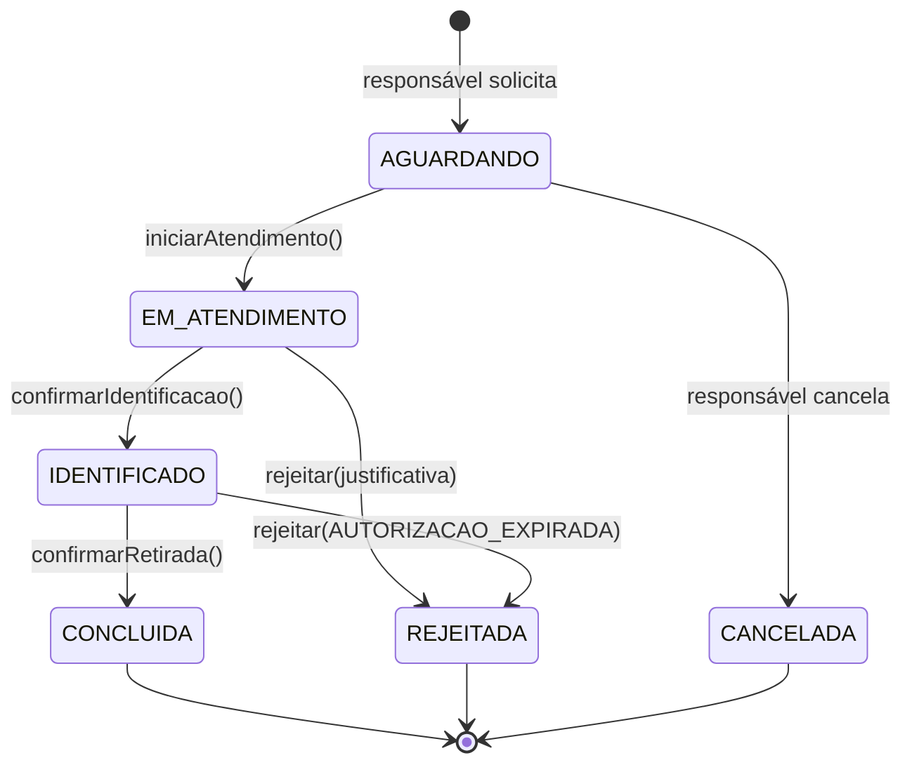

# Contrato da API — Painel da Portaria

Contrato que o backend Java (Spring Boot) deve implementar para que o painel da portaria deixe de usar dados simulados.
Fonte no frontend: `frontend/src/services/contracts/RetiradaService.ts` (interface) e `frontend/src/domain/retirada.ts` (DTOs).

Para trocar a simulação pela API real: `VITE_API_MODE=http` e `VITE_API_BASE_URL=http://localhost:8080` em `frontend/.env`. Nenhum componente precisa ser alterado.

## Princípios

- **O backend é a fonte de verdade.** A máquina de estados fica na classe de domínio `Retirada`; o frontend exibe somente as ações em `acoesPermitidas`.
- **Concorrência otimista:** toda ação envia `versao` (`@Version` no JPA). Versão divergente → `409 VERSAO_DESATUALIZADA`.
- **Autorização revalidada** em `confirmar-identificacao` e em `confirmar-retirada`.
- **QR Code válido não altera o status** nem libera o aluno.
- Erros no formato `ProblemDetail` (RFC 7807), com o campo extra `codigo`.

## Máquina de estados



## Endpoints

Base: `/api/portaria`. Todos exigem perfil `FUNCIONARIO` (ou superior) e são restritos à escola do usuário autenticado.

| Método | Caminho | Corpo | Resposta | Método do controller |
|---|---|---|---|---|
| GET | `/sessao` | — | `SessaoPortariaDTO` | `obterSessao()` |
| GET | `/retiradas?status=A,B&busca=texto` | — | `RetiradaDTO[]` em ordem FIFO (`dtSolicitacao` asc) | `listarFila(status, busca)` |
| GET | `/retiradas/{id}` | — | `RetiradaDTO` | `obterRetirada(id)` |
| GET | `/resumo` | — | `ResumoPortariaDTO` | `obterResumo()` |
| GET | `/movimentacoes?limite=10` | — | `MovimentacaoDTO[]` (mais recentes primeiro) | `listarHistorico(limite)` |
| POST | `/retiradas/{id}/iniciar-atendimento` | `{ versao }` | `RetiradaDTO` | `iniciarAtendimento(id)` |
| POST | `/retiradas/{id}/validar-identificacao` | `{ codigo }` | `ValidacaoIdentificacaoDTO` | `validarIdentificacao(id, codigo)` — **novo** |
| POST | `/retiradas/{id}/confirmar-identificacao` | `{ metodo: "QR_CODE" \| "DOCUMENTO", versao }` | `RetiradaDTO` | `confirmarIdentificacao(id)` |
| POST | `/retiradas/{id}/confirmar-retirada` | `{ versao }` | `RetiradaDTO` | `confirmarRetirada(id)` |
| POST | `/retiradas/{id}/rejeitar` | `{ motivo, justificativa, versao }` | `RetiradaDTO` | `rejeitar(id, justificativa)` |

`/sessao`, `/resumo` e `validar-identificacao` não constam no diagrama de classes atual e devem ser incluídos no `RetiradaController`/`RetiradaService`.

### Regras por endpoint

| Endpoint | Status exigido | Outras validações |
|---|---|---|
| iniciar-atendimento | `AGUARDANDO` | registra `atendidoPor` e `dtInicioAtendimento` |
| validar-identificacao | `EM_ATENDIMENTO` | não muda status; registra tentativa (auditoria); marca token como utilizado se `CONFERE` |
| confirmar-identificacao | `EM_ATENDIMENTO` | autorização vigente; se `metodo=QR_CODE`, exige QR validado |
| confirmar-retirada | `IDENTIFICADO` | autorização vigente; grava `Movimentacao` na mesma transação |
| rejeitar | `EM_ATENDIMENTO`; ou `IDENTIFICADO` somente com motivo `AUTORIZACAO_EXPIRADA` e autorização de fato não vigente | `justificativa` com 10 a 500 caracteres; `motivo` ∈ `DOCUMENTACAO_INCOMPLETA`, `IDENTIDADE_NAO_CONFERE`, `RESPONSAVEL_INDISPONIVEL`, `AUTORIZACAO_EXPIRADA`, `OUTRO`; grava `Movimentacao` |

## Resultado da validação do QR

`ValidacaoIdentificacaoDTO.resultado`: `CONFERE`, `CODIGO_INVALIDO`, `CODIGO_EXPIRADO`, `CODIGO_JA_UTILIZADO`, `SOLICITACAO_DIVERGENTE`.
Responde `200` em todos os casos (a leitura foi processada); `valido` indica se confere.

## Erros

| HTTP | `codigo` | Situação |
|---|---|---|
| 404 | `RETIRADA_NAO_ENCONTRADA` | id inexistente ou de outra escola |
| 409 | `TRANSICAO_INVALIDA` | ação não permitida no status atual |
| 409 | `VERSAO_DESATUALIZADA` | solicitação alterada por outra operação (ex.: cancelada pelo responsável) |
| 409 | `AUTORIZACAO_EXPIRADA` | autorização do responsável não está mais vigente |
| 422 | `JUSTIFICATIVA_OBRIGATORIA` | justificativa ausente ou curta |
| 422 | `QR_NAO_VALIDADO` | `metodo=QR_CODE` sem QR validado |

Exemplo:

```json
{
  "type": "about:blank",
  "title": "Conflito",
  "status": 409,
  "detail": "Ação não permitida para uma solicitação com status IDENTIFICADO.",
  "codigo": "TRANSICAO_INVALIDA"
}
```

## Tempo real (Etapa 9)

Tópico STOMP sugerido: `/topic/escolas/{escolaId}/portaria`, com eventos `RETIRADA_CRIADA`, `RETIRADA_ATUALIZADA` e `RETIRADA_CANCELADA` (somente ids e nome do aluno; o painel recarrega os dados via REST). Até lá, o modo `http` atualiza a fila a cada 10 s.

## Exceção de autorização expirada após a identificação (resolvido)

Se uma autorização temporária expirar **depois** de a solicitação chegar a `IDENTIFICADO`, a confirmação da retirada é bloqueada, mas a tabela de estados não permite rejeitar a partir de `IDENTIFICADO`. Implementado no domínio (`SolicitacaoRetirada.rejeitar`): `IDENTIFICADO → REJEITADA` apenas com motivo `AUTORIZACAO_EXPIRADA`. O serviço da portaria só aceita essa rejeição quando a autorização realmente não está vigente; nesse caso `acoesPermitidas` passa a ser `["REJEITAR"]`.

## Estado da implementação (10/11/2026)

Implementados: todos os endpoints acima, **exceto** `validar-identificacao` (QR Code), que depende da emissão de credenciais pelo app do responsável. Até lá, `confirmar-identificacao` aceita somente `metodo = "DOCUMENTO"` (`QR_CODE` → 422 `QR_NAO_VALIDADO`) e o backend não envia `VALIDAR_IDENTIFICACAO` em `acoesPermitidas`. Detalhes em `docs/INTEGRACAO.md`.
